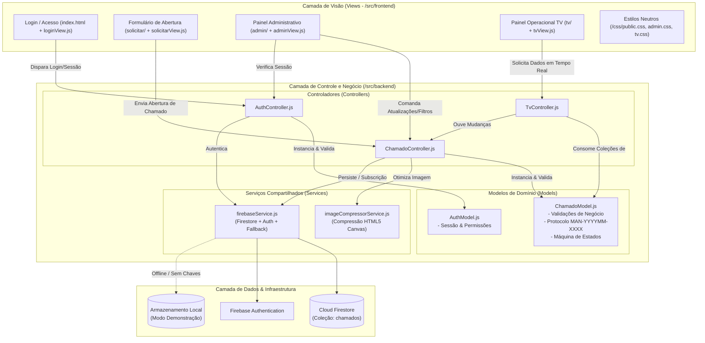
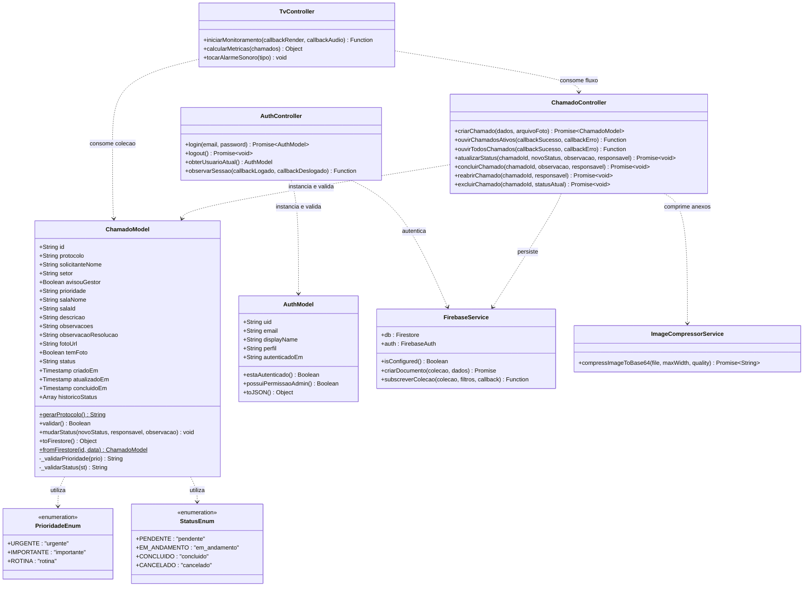

# 🏛️ Documento de Arquitetura de Software: Padrão MVC

## 1. Visão Geral do Sistema

O **Sistema de Chamados de Manutenção** é uma solução web desenvolvida para a gestão integrada e operacional de ordens de serviço e solicitações de manutenção predial e infraestrutura da **Instituição Cliente**.

A aplicação foi estruturada seguindo rigorosamente o padrão de arquitetura **MVC (Model-View-Controller)**, promovendo a separação de responsabilidades (SoC - *Separation of Concerns*), facilidade de manutenção, testabilidade e desacoplamento entre interface, regras de negócio e camada de persistência.

---

## 2. Diagrama de Arquitetura e Fluxo de Dados (Mermaid)

---

### 2.1. Diagrama de Classes UML (Mermaid)

---

## 3. Divisão de Responsabilidades no Padrão MVC

### 3.1. Camada de Modelo (`/src/backend/models/`)
Responsável pelo estado, regras de validação e integridade dos dados:
- **`ChamadoModel.js`**:
  - Encapsula a entidade de chamado de manutenção.
  - Implementa a geração do protocolo unificado no formato `MAN-YYYYMM-XXXX` (baseado em ano/mês e hash hexadecimal único).
  - Garante a validação de campos obrigatórios (nome do solicitante, setor, identificação do local, descrição detalhada).
  - Define enums estritos para Prioridades (`urgente`, `importante`, `rotina`) e Status (`pendente`, `em_andamento`, `concluido`, `cancelado`).
  - Controla o histórico de auditoria e a máquina de estados para transições válidas de status.
- **`AuthModel.js`**:
  - Modela o usuário conectado, perfil de privilégios e validade da sessão.

### 3.2. Camada de Controle (`/src/backend/controllers/`)
Orquestra o fluxo de dados entre as Visões e os Modelos/Serviços:
- **`ChamadoController.js`**:
  - `criarChamado()`: Valida os dados de entrada, delega a compressão da imagem anexada e persiste no banco.
  - `ouvirChamadosAtivos()`: Cria a subscrição em tempo real (`onSnapshot`) filtrada exclusivamente para status pendentes e em andamento.
  - `ouvirTodosChamados()`: Mantém a sincronia em tempo real de todo o acervo para o painel administrativo.
  - `atualizarStatus()`, `concluirChamado()`, `reabrirChamado()`: Altera os estados com carimbo temporal.
  - `excluirChamado()`: Aplica a **trava de segurança operacional**, impedindo o descarte de chamados ativos.
- **`AuthController.js`**:
  - Centraliza o fluxo de login, logout e observadores de rota restrita (`observarSessao`).
- **`TvController.js`**:
  - Processa os dados em tempo real para monitores operacionais, calculando métricas e acionando sintetizadores de áudio de acordo com a gravidade da notificação.

### 3.3. Camada de Visão (`/src/frontend/`)
Responsável exclusivamente pela interface com o usuário e manipulação do DOM:
- **`HTMLs`**: Estrutura semântica das páginas (`index.html`, `solicitar/index.html`, `admin/index.html`, `tv/index.html`).
- **`CSSs`**: Folhas de estilo modularizadas com paleta neutra e genérica baseada em tons de cinza e azul claro padrão.
- **`Scripts de Visão (`/src/frontend/js/views/`)`**:
  - `loginView.js`: Tratamento de eventos de login e feedback visual de erro.
  - `solicitarView.js`: Manipulação de câmera, galeria, drag-and-drop, colagem de screenshots da área de transferência e confirmação modal de urgência.
  - `adminView.js`: Renderização de tabelas, paginação, filtros reativos e geração do QR Code com a biblioteca `qrcodejs`.
  - `tvView.js`: Renderização de cards em grade responsiva, relógio em tempo real e alternância de tela cheia.

---

## 4. Otimizações de Engenharia para o Firebase Spark Plan (100% Gratuito)

1. **Compressão Automática Client-Side (`imageCompressorService.js`):**
   Fotos de alta resolução tiradas por smartphones (geralmente entre 5 MB e 12 MB) são redimensionadas via HTML5 Canvas para JPEG de até 1024px e qualidade 70%, resultando em arquivos Base64 de **40 KB a 80 KB**. Isso viabiliza o armazenamento direto no Firestore, **sem custo de Firebase Storage e sem exigência de cartão de crédito**.
2. **Subscrições Otimizadas com Filtro de Status:**
   A tela de TV assina apenas documentos com status `pendente` e `em_andamento`, evitando leituras repetidas do acervo histórico de chamados encerrados.
3. **Cache de Sessão e Modo Demonstração:**
   Caso as chaves do Firebase não estejam configuradas ou o ambiente esteja sem conectividade, o sistema ativa automaticamente um mock em `localStorage`, mantendo todas as rotas operacionais.

---

## 5. Dicionário de Dados (Cloud Firestore - Coleção `chamados`)

O armazenamento de dados no Cloud Firestore é modelado no formato de documentos NoSQL. A tabela abaixo documenta o dicionário de dados da entidade principal do sistema:

| Campo | Tipo no Banco | Obrigatório | Regras de Validação / Domínio | Descrição Funcional |
| :--- | :--- | :---: | :--- | :--- |
| `id` | `String` (Doc ID) | Sim | Gerado automaticamente pelo Firestore | Identificador único do documento na nuvem |
| `protocolo` | `String` | Sim | Máscara `MAN-YYYYMM-XXXX` (ex: `MAN-202610-0DE0`) | Código rastreável do chamado para o solicitante e equipe |
| `solicitanteNome` | `String` | Sim | Comprimento mínimo de 3 caracteres | Nome completo do usuário que abriu o chamado |
| `setor` | `String` | Sim | Valor não vazio (ex: "Administrativo", "Pedagógico") | Setor institucional de lotação do solicitante |
| `avisouGestor` | `Boolean` | Sim | `true` ou `false` (padrão: `false`) | Indica se a chefia direta foi comunicada previamente |
| `prioridade` | `String` | Sim | Enum: `urgente`, `importante`, `rotina` | Grau de impacto operacional do problema reportado |
| `salaNome` | `String` | Sim | Valor não vazio (ex: "Sala 101 - Bloco Central") | Identificação descritiva do espaço físico com avaria |
| `salaId` | `String` | Não | String alfanumérica ou idêntica a `salaNome` | Chave referencial da sala física para cruzamento cadastral |
| `descricao` | `String` | Sim | Comprimento mínimo de 5 caracteres | Relato detalhado do problema ou serviço necessário |
| `observacoes` | `String` | Não | Texto livre | Anotações adicionais inseridas na abertura |
| `observacaoResolucao` | `String` | Não | Texto livre | Parecer técnico registrado na conclusão ou cancelamento |
| `fotoUrl` | `String` | Não | Data URL Base64 (`image/jpeg`) <= 300 KB | Fotografia comprimida da anomalia predial |
| `temFoto` | `Boolean` | Sim | `true` se `fotoUrl` preenchida; senão `false` | Flag de indexação rápida para exibição de ícone de foto |
| `status` | `String` | Sim | Enum: `pendente`, `em_andamento`, `concluido`, `cancelado` | Estado atual do chamado na máquina de transição |
| `criadoEm` | `Timestamp` / ISO | Sim | Carimbo temporal do servidor | Data e hora exatas da emissão do protocolo |
| `atualizadoEm` | `Timestamp` / ISO | Sim | Atualizado a cada mudança de estado ou edição | Data e hora da última movimentação operacional |
| `concluidoEm` | `Timestamp` / ISO | Não | Nulo enquanto ativo; preenchido ao concluir | Data e hora do encerramento técnico |
| `historicoStatus` | `Array<Map>` | Sim | Lista de eventos: `{status, data, responsavel, observacao}` | Rastro de auditoria cronológico de todas as transições |

